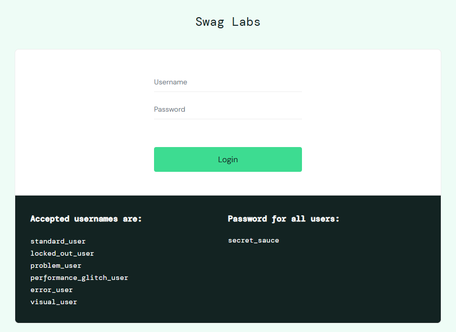
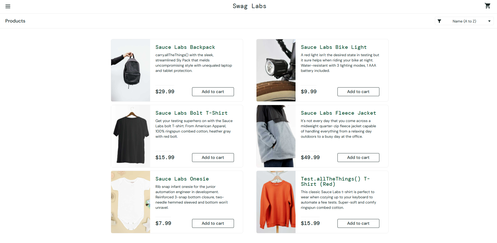
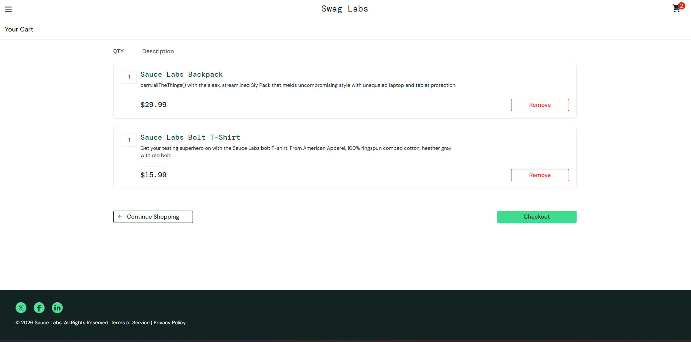
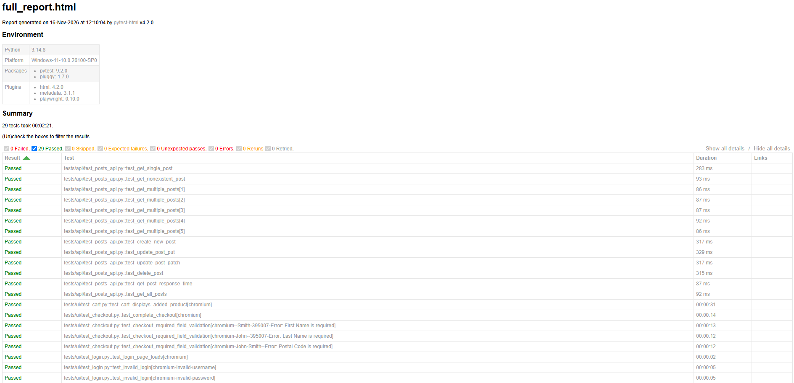
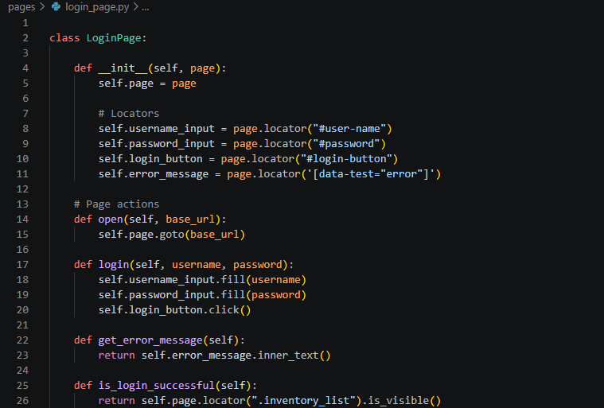
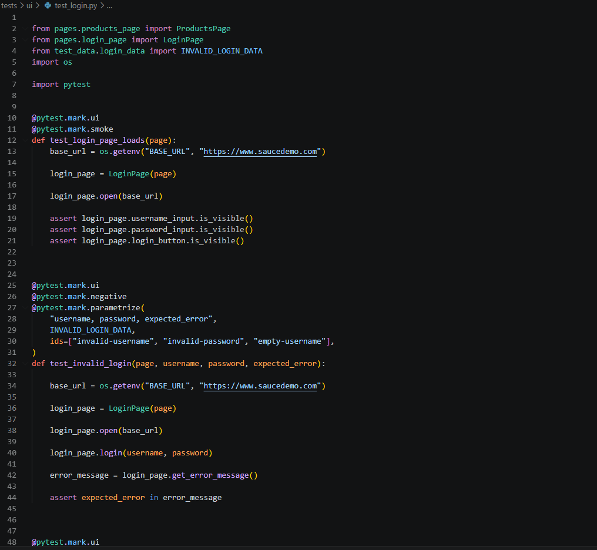
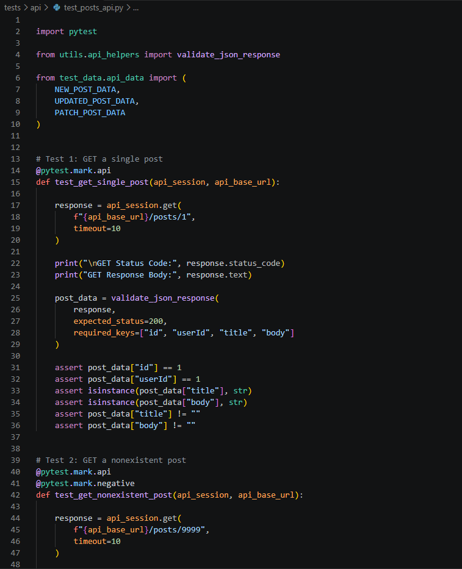
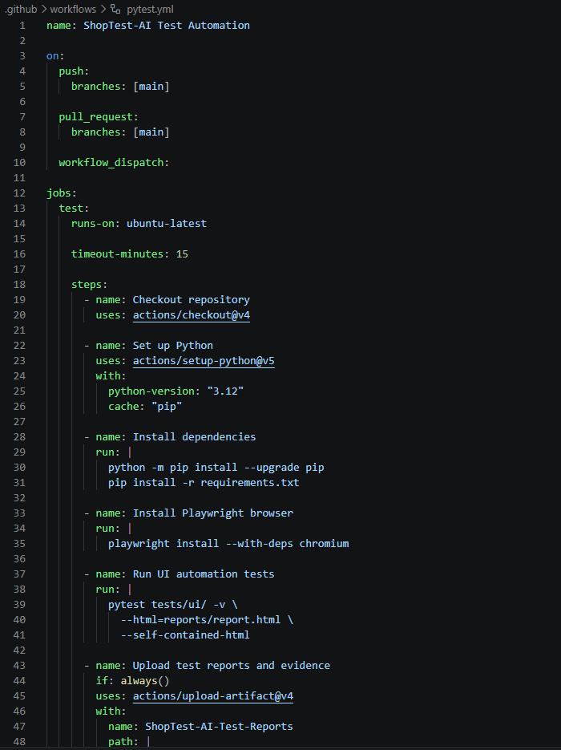

# ShopTest-AI

## E-Commerce Test Automation Framework

ShopTest-AI is a Python-based test automation framework designed to validate e-commerce application functionality through UI automation and API testing.

This project demonstrates practical software testing skills, reusable automation architecture, test data management, reporting, and continuous integration using GitHub Actions.

## Technology Stack

| Technology | Purpose |
|---|---|
| Python | Programming language |
| Playwright | UI automation |
| Pytest | Test framework |
| Requests | API automation |
| Page Object Model | Framework architecture |
| Pytest HTML | Test reporting |
| Git & GitHub | Version control |
| GitHub Actions | CI/CD |

## Project Features

- UI automation using Playwright.
- API automation using Python Requests.
- Page Object Model (POM) architecture.
- Reusable Pytest fixtures.
- Data-driven and parametrized testing.
- Positive and negative test scenarios.
- GET, POST, PUT, PATCH and DELETE API testing.
- API response validation.
- API response-time testing.
- Automated HTML test reports.
- Logging and failure screenshots.
- Continuous integration using GitHub Actions.

## Applications Under Test

**UI Testing:** [SauceDemo](https://www.saucedemo.com/)

**API Testing:** [JSONPlaceholder](https://jsonplaceholder.typicode.com/)

## Project Structure

```text
ShopTest-AI/
│
├── .github/
│   └── workflows/
│       └── pytest.yml
│
├── pages/
│   ├── login_page.py
│   ├── products_page.py
│   ├── cart_page.py
│   └── checkout_page.py
│
├── test_data/
│   ├── login_data.py
│   └── api_data.py
│
├── tests/
│   ├── ui/
│   └── api/
│
├── utils/
│   ├── api_helpers.py
│   └── logger.py
│
├── docs/
│   ├── screenshots/
│   ├── test_scenarios.md
│   ├── test_cases.md
│   ├── edge_cases.md
│   ├── risk_prioritization.md
│   └── test_strategy.md
│
├── reports/
├── logs/
├── conftest.py
├── pytest.ini
├── requirements.txt
├── .env.example
└── README.md
```

## Setup Instructions

### 1. Clone the repository

```bash
git clone https://github.com/dhruvi19work-pandas/ShopTest-AI.git
```

### 2. Navigate to the project directory

```bash
cd ShopTest-AI
```

### 3. Create a virtual environment

```bash
python -m venv .venv
```

### 4. Activate the virtual environment (Windows PowerShell)

```powershell
.\.venv\Scripts\Activate.ps1
```

### 5. Install dependencies

```bash
pip install -r requirements.txt
```

### 6. Install Playwright Chromium

```bash
playwright install chromium
```

### 7. Configure environment variables

Create a `.env` file using `.env.example` as a reference.

## Running Tests

### Run all tests

```bash
python -m pytest -v
```

### Run UI tests

```bash
python -m pytest tests/ui/ -v
```

### Run API tests

```bash
python -m pytest tests/api/ -v
```

### Generate an HTML report

```bash
python -m pytest -v --html=reports/full_report.html --self-contained-html
```

## Test Execution Results

Latest recorded full test execution:

| Result | Count |
|---|---:|
| Passed | 29 |
| Failed | 0 |
| Total | 29 |

## Continuous Integration

GitHub Actions is configured to run the UI automation test suite automatically on pushes and pull requests to the `main` branch.

## Project Documentation

The `docs/` folder contains test scenarios, test cases, edge cases, risk prioritization, and test strategy documentation.

## Project Screenshots

### 1. Application UI

**Login Page**



**Products Page**



**Shopping Cart**



### 2. Automation Test Results

**Pytest HTML Report**



### 3. Framework Implementation

**Page Object Model**



**UI Automation Tests**



**API Automation Tests**



**GitHub Actions CI/CD**



## Project Goals

- Develop practical UI and API automation skills.
- Build reusable and maintainable automation frameworks.
- Apply software testing principles and best practices.
- Understand test reporting and failure analysis.
- Gain hands-on experience with CI/CD pipelines.

## Project Status

**Core UI and API automation framework implemented.**

This is my first end-to-end test automation project. Further improvements and advanced testing capabilities may be added as the project evolves.